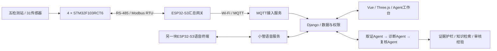

# 综合管廊数字孪生与三Agent运维系统

面向综合管廊教学台架与智能运维演示，连接 **31个物理传感器、四块STM32、ESP32-S3网关、三维孪生、三Agent工作流和“小管”语音终端**。

[当前进度](docs/PROJECT_STATUS.md) · [文档导航](docs/README.md) · [完整业务固件](firmware/four-controller/RELEASE.md) · [协作规范](CONTRIBUTING.md) · [版本记录](CHANGELOG.md)

> 更新日期：2026-10-31。软件功能、离线测试、模型调用结果与实物验收分别记录。**CTRL-02温湿度仍待定位，整机尚未完成最终验收。** 付费模型复测暂缓，实物联调网页保持只读。


*工作台截图来自2026-10-29隔离模拟环境，不是实时硬件状态。*

## 当前能力

| 模块 | 已具备的能力 | 验证与限制 |
| --- | --- | --- |
| 三Agent运维 | 取证→诊断→复核；工具轨迹、引用、快照与版本可追溯 | 离线回归可复现；真实DeepSeek复测及独立人工评分未完成 |
| 可续查排障 | 候选原因、反证、缺项、人工检查反馈、新快照续查 | 人工报告不冒充仪表测量，不自动结单 |
| 受控经验与流程 | 候选提取、管理员审核、版本与来源匹配、退役 | 未审批内容不注入；复核通过不等于根因已证实 |
| 本地只读决策 | AnyJev/Tacit闭集检查选择、超时或不合格回退 | 默认关闭，不替代诊断模型，不具有任意控制权限 |
| 三维孪生 | V24统一编号、31路独立定位、明显告警高亮、风机状态呈现 | 五路火焰触发/定位/恢复获用户确认；其他逐路验收未齐 |
| 现场采集 | 四STM32分区采集，RS-485→单S3网关→MQTT→Django | 已有四板上报记录；CTRL-02温湿度当前未恢复稳定采样 |
| 双风机 | 固件支持继电器、反相PWM、TACH与INA226反馈 | 用户确认两台曾转动；调速、测速、支路电流精度仍待验收 |
| 小管语音 | 独立S3语音终端、唤醒/流式回复、OLED表情与音量控制 | 独立于汇总网关；部署与设备状态见语音模块文档 |
| 仿真与成本 | 人工确认的仿真处置、回执复盘、双风机能耗/任务成本 | 模拟、假设与实测分别展示，不宣称真实节能收益 |

## 架构



设备命令、命令回执、输出状态、独立转速反馈和告警恢复是不同证据。**实物只读联调不开放网页硬件控制；仿真执行不计作真实MQTT/RS-485验收。**

## 实体与身份基线

实体外形 **700 × 700 × 300 mm**，四角主控、五检测站，两台排风机，无水泵。传感器为液位4、温湿度4、MQ-2/MQ-4/MQ-7各5、火焰5、氧气3，共31个物理模块；两路INA226单列，不计入31路。

| 主控 | 电气布局位置 | 物理传感器数 | 主要设备 |
| --- | --- | ---: | --- |
| CTRL-01 | 左下 | 11 | 状态副屏 |
| CTRL-02 | 右下 | 7 | 主屏、摇杆、FAN-02、继电器2、INA226-FAN2 |
| CTRL-03 | 右上 | 6 | 蜂鸣器、灯带 |
| CTRL-04 | 左上 | 7 | FAN-01、继电器1、INA226-FAN1 |

采集编号、平台资产编码、模型文字及网格绑定通过版本化清单对应；不根据数组顺序重编号。P5没有温湿度模块。实物前端使用V24统一编号；隔离软件演示仍支持按精确SHA安装V24，不能混用映射。

[接线与引脚](docs/hardware/four-controller-wiring-20261026/README.md) · [风机/继电器/INA接线](docs/hardware/fan-relay-ina226-wiring-20261029.md) · [模型版本](model/README.md)

## 获取与启动

```powershell
git clone https://github.com/x1ng-chen/utility-tunnel-digital-twin.git
cd utility-tunnel-digital-twin
git lfs install
git lfs pull
```

需要Python 3.12、Node.js 22或更高兼容版本、Git LFS。嵌入式构建另需ARM GCC、CMake、Ninja与PlatformIO；依赖以各模块锁文件为准。

| 使用方式 | 入口 | 数据与权限 |
| --- | --- | --- |
| 隔离软件演示 | [Windows/Docker启动](deploy/agent-demo/README.md)；默认 `http://127.0.0.1:5187/agent-workbench` | 模拟库；模型调用默认关闭，需显式启用 |
| 实物只读联调 | [启动说明](deploy/hardware-live/README.md)；默认前端5173/API8000 | `.hardware-live/`独立库；不发布硬件命令 |
| 小管语音 | [语音服务](services/README.md) 与 [语音终端](firmware/README.md) | 使用独立S3，沿用其专门配置与启动说明 |
| 完整固件 | [构建/发布/刷写](firmware/four-controller/RELEASE.md) | 四STM32＋网关业务镜像；2号不使用最小诊断版作发布镜像 |

**账号、密码、Wi-Fi及MQTT凭据不放在主页或固件中。** 启动器生成的访问文件与`.env`仅保存在被忽略的本地运行目录。示例配置不包含真实密钥。

## 验证与待办

本次发布的测试结果、固件指纹与CI链接见[发布验证](docs/releases/2026-10-31/README.md)。普通测试不调用付费模型、不连接真实执行器；浏览器、容器、真实模型与实物结论单独记录。

接下来优先完成：

1. CTRL-02温湿度根因定位与业务固件回装验证。
2. 双风机PWM/TACH和INA支路反馈专项验收，逐路完成其余传感器触发/恢复。
3. 显式启动真实DeepSeek回归、单/三Agent同数据对照及独立人工评分。
4. 整机断线恢复、长时间演示与后续评委公网入口。

K210视觉、趋势预测、MCP和寿命预测未纳入当前交付；仓库历史规划不代表这些功能已实现。

## 仓库结构

```text
backend/       Django API、三Agent、权限、场景与评测
frontend/      Vue工作台、Three.js孪生及界面测试
firmware/      四主控/网关业务源码、语音终端及历史固件
services/      MQTT接入、本地决策、语音服务
model/         V24统一编号及保留的历史模型交付
hardware/      硬件设计与说明
deploy/        隔离演示、只读联调和部署工具
docs/          当前进度、模块说明、验证记录与历史资料
tools/         质量门禁、模型检查与复现工具
```

旧README已归档到[历史说明](docs/history/README-before-20261031.md)。涉及双节点、旧模型、旧引脚和旧验收的记录保留出处，不作为当前操作依据。
