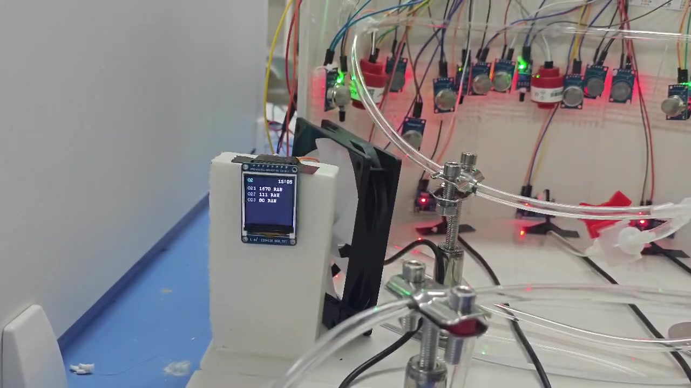
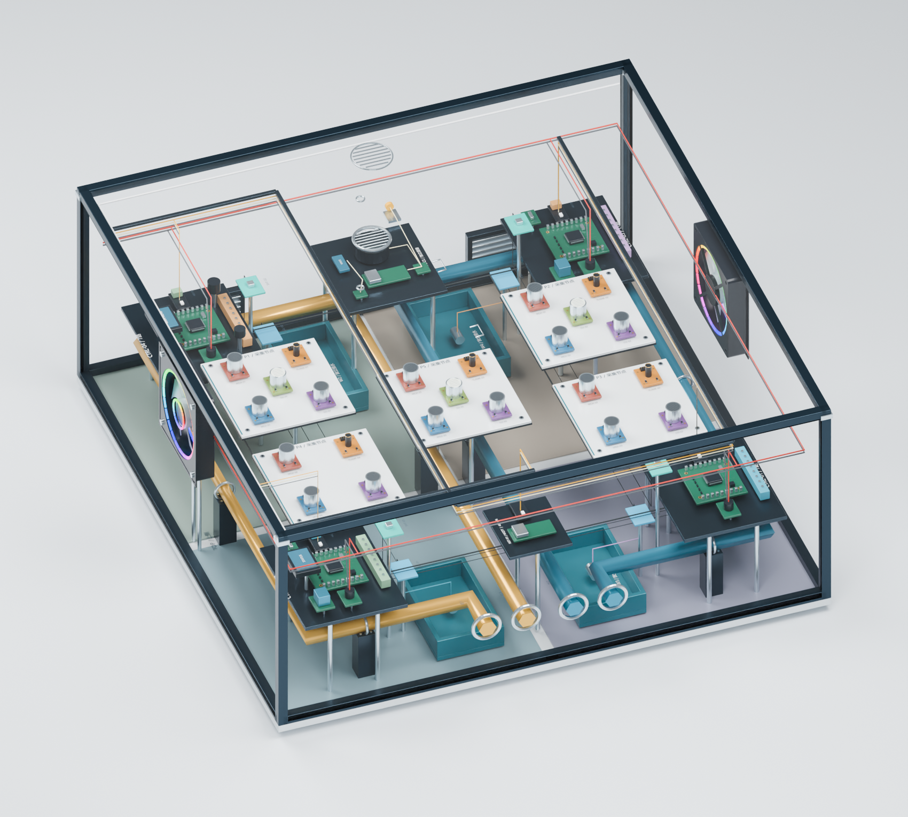
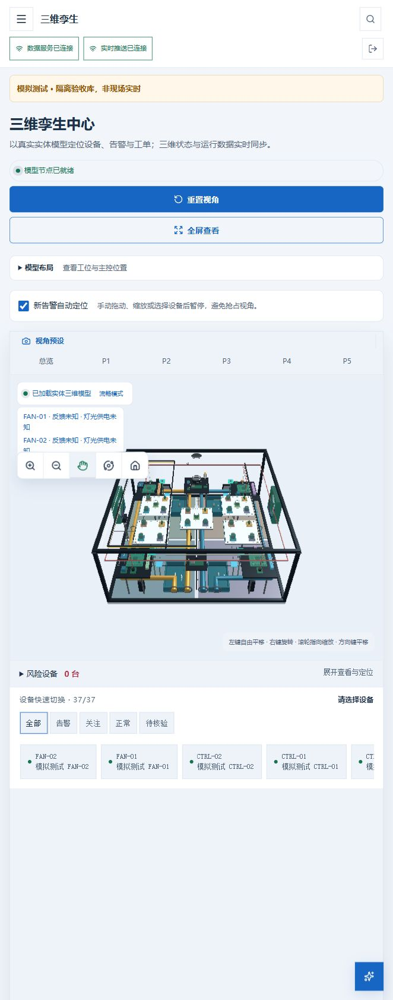
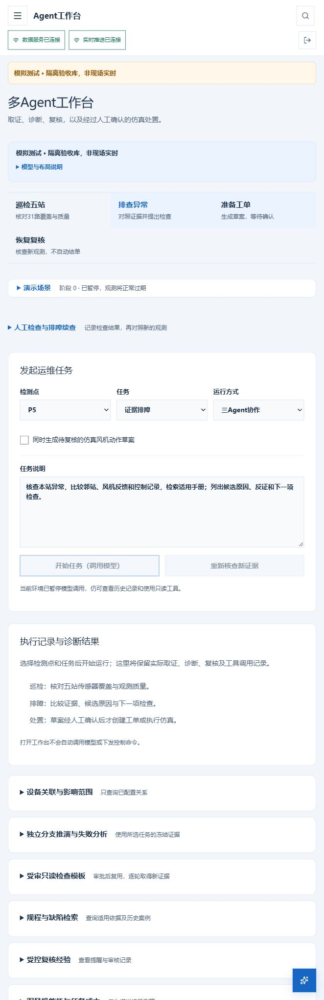
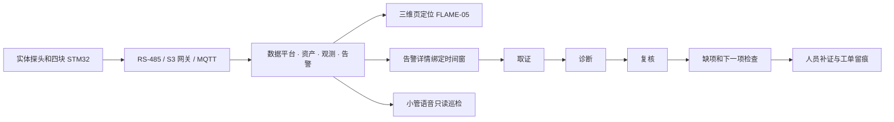

# 综合管廊数字孪生运维 Agent

**一个面向多设备、分区监测场景的运维原型。以现场告警为起点，把传感器报文、三维设备、Agent 排障记录和人工工单串在同一个资产与事件上。**

11 月 6 日的第二次 P5 联调中，实体火焰探头触发后，网页里的对应探头高亮，移开触发源后恢复。平台随后将告警 `1234` 的历史观测交给取证、诊断、复核三个角色。复核承认读数记录支持触发与恢复，同时指出现场观察和报文对照没有进入自己的冻结快照。运维人员在工单中补记核对过程，再由管理员完成工单。**一次演示同时留下了“设备发生了什么”“模型凭什么这样说”和“谁确认了处置”。** [P5 两轮实测与时间线](03-P5实物验收与证据.md)

| 想了解的问题 | 对应文档 |
| --- | --- |
| Agent 运行时到底做了哪些事，哪里体现技术工作 | [三 Agent、证据、护栏与续查](05-Agent技术亮点与实现.md) |
| 五个检测区、四块主控、网关、平台和小管如何协作 | [系统设计与实现](02-系统设计与技术实现.md) |
| 现场有哪几轮试验，各结论能追溯到哪份记录 | [P5 验收和其他台架证据](03-P5实物验收与证据.md) |
| 评委如何打开、操作、提问并核对结果 | [比赛材料及评审演示](04-比赛提交与评审演示.md) |

## 项目实物和页面长什么样

### 实物台架

图 1。10 月 20 日实物视频存档。图中可见传感器模块、透明管路、布线、OLED 和风机。屏幕的 `RAW` 字样表示当时展示原始读数。此图记录早期装配形态。11 月 6 日验收范围见现场记录，成片可用同一机位补拍最终四板台架和 P5 探头。

### 五站三维孪生

图 2。V24 模型渲染存档。透明外壳下能看到五个检测站的白色传感器托板、角部主控、内侧管线及两侧嵌入式风机。P5 在中央区域。观察视角可以旋转，电气归属以现行台账为准。风机带灯图是几何和材质预览。

图 3。10 月 29 日隔离库浏览器截图，页面保留“模拟测试”标识。三维页提供全局与 P1–P5 视角、设备选择和风险定位。实际 P5 高亮及恢复由 11 月 6 日的现场观察确认。

### Agent 工作台

图 4。10 月 29 日隔离库界面留档。上方为巡检、排障、工单草案、恢复复核四类任务，下方是工位、任务及运行方式，选定后明确开始。实际运行后的执行记录按角色展开模型请求、工具、状态和证据。截图时模型暂停，11 月 6 日 P5 的真实运行以归档任务为依据。

## 业务场景与使用者

假设监控值班员接到一条很短的火焰信号。等打开曲线时，探头已经回到 0。此时最有价值的问题是：当时有哪几条有效观测，位置在哪里，涉及哪块主控，恢复由什么支持，还要检查什么。这些信息分散在实时画面、历史数据、固件或接线说明和人工记录里。项目让它们围绕一条可追踪的告警汇合。

| 使用者 | 可以完成的事 | 产物 |
| --- | --- | --- |
| 值班员 | 按站点巡检，核对数据是否新鲜，定位告警，提交排障任务 | 带来源和时间的巡检结果、告警及定位 |
| 设备运维人员 | 查看候选原因与反证，按待查项做现场检查，在权限内处理工单 | 现场检查记录、后续排障、工单过程 |
| 复核人 | 对照原始观测、模型复核和人员补充证据，确认处置 | 复核意见、操作时间和状态轨迹 |
| 评审人员 | 对历史实测回放做只读查询、排障和复核，展开轨迹自行判断 | 与所选告警关联的任务结果及证据 |

## 从发现到结单

- **先定位再排障。** 工位和资产编号横跨固件、数据、告警、三维和任务。P5 的 `FLAME-05` 触发，系统定位到具体探头，人员可从该条告警进入排障。
- **告警已经结束也能追溯。** 任务绑定告警前后窗口并冻结观测。即使回到正常读数、后台收到新报文，或模型调用失败后再试，旧任务的依据仍然能解释。
- **模型结论和业务状态分开。** 复核可要求修改或补证。现场人员依据自己的检查结果处理工单，模型输出、人的记录和状态变化各自留痕。
- **小管和网页查同一套数据。** 小管是基于小智的独立 ESP32-S3 语音终端，用于现场免手操作的站点巡检。网页负责查看细粒度证据和工单操作。

## 目前的完成程度

| 范围 | 已有记录 | 边界 |
| --- | --- | --- |
| 四主控与五站 | 有四板上报、五站资产映射。31 路资产登记，现场配置启用 30 路 | 启用、收到帧和获得良好新鲜观测是三个不同统计口径 |
| 实物到三维到工单 | 11 月 6 日完成两次 P5 实物告警、高亮恢复及人工结单 | 两次 Agent 复核均保留需修改或补证意见 |
| 三 Agent 与知识检索 | 真实 DeepSeek 任务有取证、诊断、复核轨迹，另有角色权限及回归用例 | 各场景的结果需单独核对，暂无可对外宣称的准确率或效率提升 |
| 小管 | 已在现场使用语音查询 P5，保留为只读入口 | 口头“正常”应以该次返回的数据、时间与缺项解读，P5 台账本身没有温湿度 |
| K210 视觉探索 | 做过摄像头取样、LCD 预览方向修正和 P5 观察区域对准 | 火焰与反光区分、烟雾验收尚未完成，视觉信号未纳入主线 |
| 评审访问 | 有 P5 历史样例和独立评审的部署设计 | 公网登录、任务可运行和评审账号权限须在实际地址验收 |

**参赛定位。** 本作品覆盖真实业务任务、可操作智能体和可复核结果。双风机、三维和语音用于说明输入及交互，核心展示用一次真实告警检验 Agent 能否找到对的证据、说清判断边界，并把仍需核查的事项交给人。
