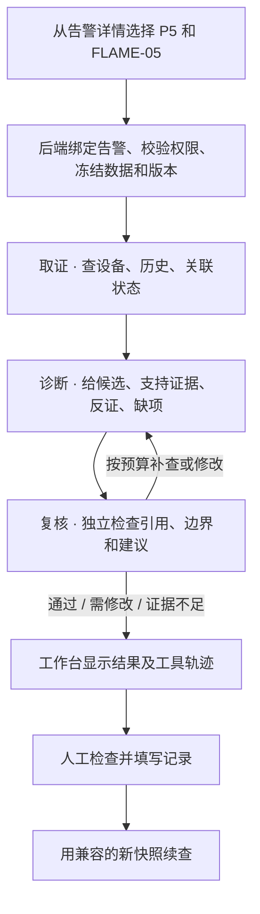

# 运维 Agent 技术详解

**以一条实际告警作为任务对象，通过受控工具取得现场证据，再由不同角色解释、质疑和复核，最终给人员留下可以执行的检查项。** 最有代表性的结果是 P5 告警 `1234`。模型找到了触发和恢复读数，独立复核仍要求修改，页面与工单保留了这个差异。[P5 验收与归档](03-P5实物验收与证据.md)

## 1. 同一句话，问答、监控和 Agent 各能做什么

任务示例：“复盘 P5 的这条告警，分别说明触发、恢复的证据，并给出一项能缩小范围的检查。”

| 方式 | 运行行为 | 结果怎么核验 |
| --- | --- | --- |
| 查监控 | 当前读数、历史曲线、告警和三维定位 | 人员自己把曲线、资产、工单和异常时间对上 |
| 普通模型问答对照 | 根据一次性输入包给出解释 | 人员核对模型引用和缺项，输入包外的事实须额外取得 |
| 单 Agent | 在同一任务上下文内调用受控工具，组织自己的候选和建议 | 有工具执行轨迹和证据约束。可作为衡量三角色代价的基线 |
| 三 Agent 协作 | 取证、诊断、独立复核分阶段运行，有受限补查和修改机会 | 分开看三角色输出、实际查询、模型拒答或错误、复核决策和下一项检查 |

三角色可以使用同一模型提供方，差异来自职责、上下文和工具权限。单 Agent 已能完成不少合理判断。三角色的实测价值应围绕“有没有发现具体证据越界”“修改有没有改善证据表述”“多花多少时间”评价。

## 2. 一次任务的执行契约

| 阶段 | 允许或需要做什么 | 可在轨迹核验的产物 |
| --- | --- | --- |
| 任务入口 | 从选中告警或站点构建范围。URL 预选经白名单校验，真正开始由用户触发 | 工位、资产、告警、任务种类、数据来源、运行方式 |
| 取证 | 调用本站、资产、趋势、关联告警/工单、拓扑等读取工具。针对工单复核读取实际工单记录 | 有状态、返回或拒绝原因的工具步骤，采样时间、质量、单位、原始观测编号 |
| 诊断 | 基于取证结果查手册、知识片段和拓扑，构造候选原因，逐项给支持、反证、缺项与下一项检查 | 结构化候选和证据引用。可按配置生成待审核草案 |
| 复核 | 用自己的读取权限复查证据、源和结论是否匹配，可指出错误引用、跨时间误用、读数或回执解释越界 | 复核意见、缺项、请求修改或最终状态。追查时可区分角色责任 |
| 任务结果 | 服务端检查结构、引用和有护栏的断言。保存角色输出、调用次数、用时、快照版本和散列 | 任务是否完成、证据够不够、业务有没有实际处置三个独立结果 |

执行预算为每任务 120 秒、最多 12 次模型调用和 12 次工具调用。存在有限的补查和诊断修订路径，任务不会因缺测而无限自循环。服务端使用允许的工具集合和参数，模型无法通过提示词获得任意 URL、SQL、Shell 或实物下发能力。

## 3. 为什么要冻结告警，冻结了什么

11 月 3 日，P5 告警 `831` 触发后恢复。真实模型遇到 HTTP 503，另一次已跑到取证，看到的是当前良好质量的 0。它明确报告普通趋势有截断，无法核对已经发生的触发。这个失败决定了后续功能的设计。

1. 从告警对象读取 **资产、指标、触发时间和恢复时间**。告警复盘查询以触发前 30 秒至恢复后 30 秒为目标，结束时间受快照生成时点约束。告警未恢复时先记录截至冻结时可用的历史。
2. 数据筛选同时使用 `recorded_at` 和 `ingested_at`。前者决定观测是否属于时间窗，后者保证冻结时尚未入库的补传读数不进入旧任务。晚到数据可进入后续新任务。
3. `alertEvent` 保存事件边界、来源、观测时间、质量、观测类型和来源信息。高密度区间保留头尾各最多 60 条，有实际省略时标记截断。缺失区间在界面与推理中应作为未知。
4. 同一任务还冻结台账、资产状态、规则和知识版本、拓扑等上下文并记录散列。失败重试沿用原快照。要用新增观测或现场检查时，建立有关系的新任务，前后分别可追溯。
5. 从已经恢复的告警也能创建关联工单。按来源告警限制唯一记录，重复提交复用现有单。权限验证和状态变更由后端业务接口处理。

**P5 样例。** 历史证据记录 `FLAME-05` 有效的 `0 → 1 → 0`，因此能解释这条告警的触发与恢复。任务创建时读到的另一个当前 0，只能证明对应新观测时点的输入状态。`latched_event` 则记录短事件锁存，应和瞬时采样、质量分别解释。[831 与 1234 对照](03-P5实物验收与证据.md)

## 4. 哪些资料能作证，哪些只能辅助解释

| 类型 | 举例 | 用法 |
| --- | --- | --- |
| `E` 工具证据 | 设备查询、告警窗口观测、工单、现场报告等工具实际返回内容 | 回到实际步骤核对来源、时间、状态和载荷。只有成功返回的 E 能作为 `evidence_ids` 引用。人工报告仍按其本身的来源解释 |
| `G` 确定性检查 | 风机动作、恢复、未标定模拟量等规则所做的检查 | 写入独立字段，可说明规则如何限制结论。数值事实仍回到具体观测 |
| `K` 项目知识 | 现行台账/接线、固件验证资料、历史故障、检查手册或有出处的标准片段 | 支持提出检查与解释。要核对适用版本和范围，历史案例仅提供候选 |
| 工具拒绝 | 工具权限不足、参数不合规或范围不匹配 | 记录拒绝轨迹，可以解释为什么这项证据没取得 |
| 人员补充 | 观察叶轮、检查接线、记录无法检查 | 保存检查者和过程，后续与新观测对照 |

知识由服务端检索，支持本地 BM25 和可选的本地 BGE 语义检索。取回的片段带来源或版本，供模型形成候选和检查建议。例如同一主控下多个输入同时缺测时可查供电、总线和采集任务。拓扑只能说明这些点有共用依赖，根因还需排查验证。评审版可用 P5 例子展示“P5 没有温湿度”来自台账，“此次火焰探头由 1 回到 0”来自历史观测，二者分别引用。

### 知识库具体装了什么

| 来源 | 随片段保留的信息 | 使用例子 |
| --- | --- | --- |
| 四主控现行接线与归属 | 来源文件、行号、版本、布局、内容散列 | 查 FLAME-05 属于哪一站、哪块主控。实际采集和接线状态另用测量核对 |
| 四主控固件修复验证 | 版本、来源位置、软件验证标记 | 区分输入寄存器、事件锁存与读数质量。软件验证只支持相应范围 |
| 旧双节点历史缺陷 | 历史来源、旧布局、部分核验标记 | 用作类似缺陷的候选。不能沿用旧接线或旧设备关系 |
| 项目内部检查手册 | 手册名称、步骤、版本、审批状态 | 为下一项检查提供顺序。候选手册按其审核状态解释 |
| 可核验标准片段 | 只有核过正文且带条款、页码或章节链接的条目才装载 | 用于限定范围内的建议。当前项目没有据此做全面标准合规认定 |

文档按片段建立索引，设备编号等词可用关键词召回。可选的本地 BGE 为 BAAI/bge-small-zh-v1.5。10 月 29 日发布档案记录运行在关键词降级模式，因此参赛材料可介绍混合检索的实现选项，效果展示采用评审地址实际返回的检索模式。

## 5. 有哪些可复现的护栏

| 典型错误 | 实际控制 | 通过所需的证据 |
| --- | --- | --- |
| “指令确认，所以风机已经转” | 风机动作检查分开回执、输出、电参量和 TACH，结构化转动声明接受校验 | 对应风机的可信 TACH 或按来源说明的现场观察 |
| “现在是 0，所以那条告警已经恢复” | 历史事件按时间引用冻结观测，独立恢复检查要求范围、规则、有效观测和当前活动告警核查 | 同一资产、指标和所需时点的证据 |
| “MQ 模拟量对应某 ppm，可以进入” | 未标定模拟量的浓度和安全结论受约束 | 有可追溯的标定、单位和适用安全规程后再评估 |
| “模型建议之后就启动现场设备” | 动作工具只生成受约束的仿真草案，模型工具不连接现场执行 | 人工权限、配置和业务层审核分别管理 |
| 伪造观测引用或越范围 | 对引用编号、结构、目标与部分结构化断言校验，按轮暴露可用断言范围 | 可展开的工具记录、实际输入和返回结果 |

**具体阻断实例。** 在 DIA-02 的冻结测试包上，用真实 DeepSeek 比较普通问答、单 Agent 和三 Agent。三角色首轮在尝试作出 `MQ4-05` 恢复断言时，`RECOVERY-1` 将其阻断。随后把每轮允许断言的范围明确写进角色输入，同一快照重试得到三个角色、六次调用的完整输出。普通问答也识别出“有电参量但缺少 TACH 证据”。案例展示了拦截和修正过程，样本量不足以给出三 Agent 的优越性结论。[联调对照和计量口径](03-P5实物验收与证据.md)

结构校验覆盖引用和若干重点业务断言。复核返回通过后，仍需要人员检查自由文本与现场情况是否一致。`completed` 表示工作流运行结束，可同时得到 `unresolved_review` 或 `insufficient`。

## 6. 有些事情现场需要多查一轮

排障档案保存每轮快照、候选解释、支持/反证、缺项及待检查事项。人员可以填写“已检查”或“无法检查”，再用相容的来源、布局和目标续查。新一轮给出变化项，并保留原结论。例：风机第 1 阶段有供电且 TACH 待核验，现场观察未转。第 2 阶段重新启动后现场看到转动，可以更新这一次观察，仍需区分第 1 阶段的故障根因。

| 已实现的扩展 | 实际用途与状态 |
| --- | --- |
| 依赖拓扑 | 查询目标的共用主控、影响范围、同站关系及绑定情况。辅助选出优先检查点 |
| 受审只读流程 | 从成功查询步骤提取候选，做零模型、零命令的工具可执行性检查。管理员批准、版本与数据源匹配后复用，退役后停止加载 |
| 受控复核经验 | 由有修订和后续通过记录的任务产生候选，经管理员审批共享。按来源和版本匹配，每次最多 3 条，每条最多 300 字，作为低信任提醒 |
| 独立分支推演 | 同一冻结模拟快照比较最多 3 个双风机方案。使用显式教学参数，分开回执、输出和 RPM。可记录假设，无实测风机曲线或气体扩散结论 |
| 本地只读工具路由 | 可选 AnyJev/Tacit 闭集路由，在预设查询中选择。低把握或异常回退常规路径，默认关闭 |
| 失败轨迹分析 | 提取首个结构、护栏、工具或产品缺项，供人员制作回归候选。修正规则与发布知识有独立审批流程 |

这些能力按项目本地源码和软件验证记录介绍。比赛公网验收优先跑通巡检、历史告警排障和恢复/工单复核三项。

## 7. 答辩中最值得当场展开的记录

1. **告警详情和任务范围。** 展示 `1234` → `P5 / FLAME-05`，让评审看清为什么这是同一台设备、同一事件。
2. **E 历史证据。** 展开触发和恢复时段，再和当前 0 的时点对照。确认好的瞬时采样与锁存条目分开解释。
3. **复核退回。** 展开三个角色和实际模型/工具步骤，指出复核认可的数据结论以及未进入快照的两类证据。
4. **人员处理。** 打开同一告警的关联工单，核查补充了什么、由谁操作、什么时间完成，保留业务结单和 Agent 复核的区别。

实现查证入口（仓库相对路径）为 `backend/operations/sprint_agents.py`、`agent_guardrails.py`、`sprint_knowledge.py`、`agent_topology.py`、`agent_investigations.py`、`agent_procedures.py`、`agent_experience.py`，界面见 `frontend/src/views/AgentWorkbenchView.vue`。比赛演示动作和提示词见[评审演示](04-比赛提交与评审演示.md)。
