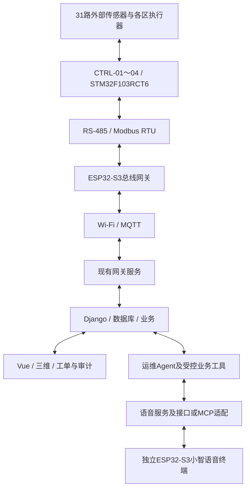

# 四主控综合管廊总体方案

版本：V1.0 · 确认日期：2026-10-23 · 状态：总体架构已确认，详细设计与四节点整机验收待完成。

本方案依据项目负责人在本轮讨论中的确认发布，供协作者共同实施。四主控、双ESP32-S3及长方体结构取代旧双节点、双ESP8266和环形外形的目标设计；旧代码、接线和验收记录保留用于迁移与追溯，不因发布本文件而视为新系统已实现。**当前暂停建模，先完成接口、接线、供电和安装条件确认。**

任务认领、依赖和完成证据见[协作任务清单](four-controller-collaboration.md)。

## 1. 已确认配置

| 项目 | 确认方案 | 实施边界 |
| --- | --- | --- |
| 结构 | 长方体，概念外形1000×400×450 mm | 不是加工尺寸冻结；安装、线槽、检修和接水空间待复核 |
| 现场主控 | STM32F103RCT6×4，编号CTRL-01～04 | 引脚与固件配置待逐板核对 |
| 外部传感器 | 液位4、温湿度4、MQ-2/MQ-4/MQ-7各5、火焰5、氧气3，共31路 | 不改用MQ-5；不增加液位第五路 |
| 执行与交互 | 风机2、继电器2路、屏幕2块、摇杆1、蜂鸣器、现有灯带 | 全部保留；驱动接口和最终归属待冻结 |
| 电流/电压监测 | INA226×2 | 额外保留，不计入31路外部传感器 |
| 联网网关 | ESP32-S3×1 | 专门负责RS-485轮询、汇总、MQTT和命令回执 |
| 语音终端 | 同款ESP32-S3×1及现有小智语音配件 | 独立于总线网关，不承担31路采集调度 |
| 板间通信 | RS-485两线半双工总线，Modbus RTU | 寄存器、轮询周期及异常处理尚未冻结 |
| 积水演示 | 四区独立接水位置，演示渗水/积水 | 不新增循环泵、储水箱或循环水路 |

数量核对：4＋4＋5＋5＋5＋5＋3＝31。温湿度模块按物理模块计1路，包含温度、湿度两个测量值。增加主控的目的是缩短局部接线、划分安装维护区域，不是证明原主控计算能力不足。

项目负责人确认已有两块同款ESP32-S3；语音配件清单标注开发板为N16R8，包含INMP441麦克风、MAX98357功放、8Ω/3W额定喇叭、0.91英寸四脚OLED、轻触按键、连接线和面包板。实际板卡版本、固件、引脚及供电仍需核对；配件清单不等于语音已跑通，也不能据此认定具备稳定全双工或远场拾音能力。

## 2. 四个分区与五组检测点

沿长度方向，以左端为x＝0，四块主控的概念中心位置分别为125、375、625、875 mm。

五组气体/火焰检测点P1～P5暂设于x＝100、300、500、700、900 mm。每组包含MQ-2、MQ-4、MQ-7、火焰各1个，共20路。每个控制分区设置液位、温湿度各1个，共8路；氧气前、中、后各1个，共3路。

以下为**建议归属，待接线与资源检查后冻结**。P1～P5仅为本方案的位置代号，不能替代或重命名现有资产编号。

| 节点 | 检测点与独立测量模块 | 路数 | 其他建议职责 |
| --- | --- | ---: | --- |
| CTRL-01 | P1四路＋本区液位、温湿度＋前部氧气 | 7 | 状态副屏、风机1、继电器1路、INA226一块 |
| CTRL-02 | P2四路＋本区液位、温湿度 | 6 | 主屏、摇杆、蜂鸣器、现有灯带 |
| CTRL-03 | P3、P4共八路＋本区液位、温湿度＋中部氧气 | 11 | 中部两组检测点采集 |
| CTRL-04 | P5四路＋本区液位、温湿度＋后部氧气 | 7 | 风机2、继电器1路、INA226一块 |
| 合计 | 五组检测点20＋液位4＋温湿度4＋氧气3 | 31 | INA226单独统计 |

不强求四板数量相同。CTRL-03承担两组检测点，有助于保留检测点完整性并减轻主屏所在CTRL-02的交互任务；最终还须检查ADC、定时器、I²C、UART和实际线长。氧气的“中部”与P3/P4精确相对位置在布局时确定。

接线迁移表必须包含现有资产编号、实物标签、原节点/引脚、新节点/引脚、接口类型、供电与信号电平、分区、检测点和三维对象。每个物理传感器只能归属一次；不得直接按旧三维模型的空安装位增加实物数量。

## 3. 系统关系



- 网关与语音板通过网络接入平台；当前不增加两板之间的串口连接。
- Agent和大模型服务运行于现有电脑/服务器及所选模型服务，不要求在ESP32本地运行大语言模型。具体语音服务与部署方式待定。
- 四节点继续使用现有MQTT遥测契约，由适配层扩展节点身份与状态；不凭本文件修改已验证的字段语义。
- 前端、三维和AI读取同一套资产、时间与数据质量信息；历史、模拟、过期数据不能冒充实时数据。
- 总线网关在线与各STM32在线分别判断；不能用一个MQTT连接的在线状态代表四个节点全部在线。

## 4. RS-485模块与接线基线

### 4.1 用户选定模块

选定商品图片中的**非隔离JSM485黑色模块，带SW1控制120Ω终端电阻**，尺寸标注约33×17 mm。商品标注3.0～5.5V供电、半双工、多点通信；从无DE/RE外接脚的接口及板上电路判断为自动收发类型，具体切换时序仍需实测。

采购计划为5块使用，建议另备1块，共6块；这是选型/数量计划，不是已付款、已到货或已验收证明。不要与随后讨论过的“双隔离型、板载120Ω需调整”的另一款混用接线定义。

模块选择依据：用户提供的该款商品详情图；[JSM485ESA原厂说明](https://www.jsmsemi.com/news/show-5513.html)用于核对芯片基本范围。商品“零丢包、2Mbps、1219米”等宣传不作为系统验收承诺；芯片规格也不能替代整块模块的验证。

### 4.2 供电与引脚

五块模块统一按3.3V供电，接线依据**所选商品图的特定命名**：

| 所选模块引脚 | 连接 |
| --- | --- |
| 3V3 | 主控3.3V电源，容量经核算 |
| GND | 对应主控GND；非隔离总线按统一低压参考地设计 |
| TXD | 主控UART TX |
| RXD | 主控UART RX |
| NC | 悬空 |
| A、B | 沿总线主干连接同款模块A、B |

这款图片明确写“TX和RX无需交叉”；不能套用到另一款隔离模块，后者图片定义为交叉连接。收到模块后先核对丝印、方向及UART输出电平，选用最终引脚表，不凭线色猜测。

总线按主干串接、短支线接入，A/B使用双绞线。参考地、执行器大电流回路与通信布线一起设计；不得把非隔离模块误认为具有隔离保护。

### 4.3 终端与调试

```text
网关 —— CTRL-01 —— CTRL-02 —— CTRL-03 —— CTRL-04
120Ω       OFF        OFF        OFF        120Ω
```

上图假设网关与CTRL-04位于物理两端；若网关位置调整，终端跟随实际电缆两端。仅两个末端SW1为ON，中间三个为OFF，不在五块板上同时启用120Ω。

- 初始调试建议19200 bit/s；串口格式、地址、轮询周期和超时由通信契约冻结后统一配置。
- Modbus从站地址建议1～4对应CTRL-01～04，ESP32为唯一总线主站；当前为接口提案，未写入固件。
- 先验证一主一从的双向通信、校验和收发切换，再扩展四从站，检查异常节点是否拖累其他节点。
- 需核对板载偏置网络，不能把多个模块的偏置简单叠加后不做检查。
- 保留连续轮询、校验失败、重试、断线恢复和上电默认状态的实际记录。

终端匹配原则参考[TI RS-485布线说明](https://www.ti.com/video/6117386152001)。系统稳定性需整机联调，不能只凭模块型号确认。

## 5. 供电、本地保护与命令

采用统一低压供电入口、沿线电源主干和分区稳压。电源容量、分区电流、线径、保险/限流、接地及掉电行为待核算，尚未冻结整机电源额定值。

功耗预算必须包括15个MQ模块的加热负载、四块STM32、两个ESP32、五个485模块、风机启动、继电器、两屏、灯带、语音功放和传感器。按具体模块资料核对模拟输出电平、ADC量程、加热要求及INA226的实际监测回路，不能把未标定原始量直接当浓度。

| 故障或操作 | 已确认行为/实施要求 |
| --- | --- |
| 语音终端或模型服务停机 | 网关和现场采集保持独立；平台明确提示语音/AI不可用 |
| 总线网关停机 | 各STM32继续采集并执行已定义的本地保护；跨区集中联动暂不可用 |
| 某一STM32掉线 | 单独标记该节点与其资产过期/离线，其他节点继续轮询 |
| 数据过期/缺失 | 保留时间和质量信息，不能继续显示“当前正常”或用0冒充有效测量 |
| 远程命令 | 校验目标、权限、有效期和去重标识；区分接收、执行与可观测结果，等待对应回执 |
| 重启或重连 | 重新同步身份和状态，防止旧命令重复执行；具体规则待契约冻结 |

本地保护触发条件、执行器安全状态、手动/本地保护/远程命令优先级及恢复条件必须形成状态表后实施。跨区数据不能在通信中断后继续当作新鲜输入。命令应答不等于已经测得风机真实转速或继电器机械动作；没有反馈硬件的能力必须明确标注。

四个接水区与电子设备保持空间隔离；实际安装位置和检修空间核对后才进入模型设计。

## 6. AI Agent参赛功能

项目负责人已确认报名，按2026-11-10提交节点组织工作；官网后续规则及报名系统格式以实际发布为准：[大赛官网](https://www.ai-race.com.cn/)。旧参赛文档中的10月20日日期不再作为本轮排期依据。

目标定位：可追溯的综合管廊语音运维Agent。复用现有业务工具、权限和工单流程，不为参赛强行增加多智能体、GPU、摄像头或传感器。

| 优先级 | 目标 | 当前实施边界 |
| --- | --- | --- |
| P0 | 语音查询实际采样、告警、心跳与数据质量，并播报采样时间 | 语音到业务的接入尚未联调 |
| P0 | 查询证据＋排查手册，区分已知事实、可能原因和缺失信息 | 现有Agent分支有受控查询基础；真实模型效果待验收 |
| P0 | 草案→网页人工确认→创建工单→审计→恢复复核 | 已有部分实现，需在选定集成版本复测；语音不能代替身份认证 |
| P1 | 根据业务资产编号定位和突出三维设备 | 需新增接口/交互，不能声称自动定位已完成；新模型仍暂停 |
| P1 | 生成四区巡检摘要和待处理事项 | 先完成证据闭环，再考虑报告归档与定时任务 |

语音与网页共用业务事实和权限。Agent首版不提供直接操作风机/继电器、任意SQL、shell或任意URL访问的工具；设备控制仍走受控平台流程，本地确定性保护不依赖AI。MCP是可选接入方式，是否采用以语音服务与现有Agent接口对接结果为准。

建议先支持按键说话、播报时暂停监听，再实测风机噪声、误识别、取消与超时；不预先承诺免按键远场和稳定全双工。服务端保存模型密钥，设备凭据单独管理；不将真实密钥提交到仓库。

核心演示：真实节点正常上报→人为断开一个节点通信→语音询问→查心跳/时间/告警→明确数据过期而非“环境正常”→检索排查手册→查已有工单→生成草案→网页人工确认→恢复后查看新采样并人工复核。需要模拟事件时显著标注，旧模型可作过渡演示但不能冒充新四区实体。

## 7. 可复用代码与历史证据

以下为已核查快照，不是要求直接合并整个分支：

| 入口 | 提交/用途 | 边界 |
| --- | --- | --- |
| [旧台架固件与接线](https://github.com/x1ng-chen/utility-tunnel-digital-twin/tree/a7dc9b471357c1e5a49f3c82c02e187100f79f00) | 双节点、ESP8266、屏幕/摇杆与旧31路接线迁移参考 | 不是四节点新固件 |
| [可追溯Agent实现](https://github.com/x1ng-chen/utility-tunnel-digital-twin/tree/a783b318d748b970eb0a8f6bc03aac58037e434e) | 受控查询、证据、手册检索和工单草案 | 不推定已合并main、已部署或真实模型已通过 |
| [已有参赛方案](https://github.com/x1ng-chen/utility-tunnel-digital-twin/blob/a783b318d748b970eb0a8f6bc03aac58037e434e/docs/AI智能体参赛升级方案.md) | 历史能力与边界说明 | 双节点架构和旧截止日期需按本方案迁移 |
| [30题验收集](https://github.com/x1ng-chen/utility-tunnel-digital-twin/blob/a783b318d748b970eb0a8f6bc03aac58037e434e/docs/AI智能体验收题集.md) | 数据、告警、离线、工单、安全测试入口 | 不填未经执行的准确率，增加语音测试 |
| [旧项目方验收](acceptance/2026-09-28-项目方验收状态.md) | 原两节点系统历史结论 | 不能作为新四节点、485、双S3与语音已通过的证明 |
| [仓库清理记录](repository-cleanup-2026-10-23.md) | 历史文件恢复入口 | 不据旧Carrier32设计直接制作新四节点硬件 |

## 8. 实施顺序与放行条件

1. 冻结31路资产归属、执行器归属及新旧接线迁移表。
2. 核对板卡、模块、引脚、信号电平，完成整机供电预算与本地保护状态表。
3. 冻结Modbus寄存器、四节点MQTT映射、命令与回执规则，开展一主一从台架。
4. 可并行开展语音到现有Agent的最小查询闭环，使用可核实数据，不等待新模型。
5. 扩展四节点固件、网关与平台，验证节点独立状态和命令目标。
6. 接线、线槽、接水、板卡安装及检修空间评审完成，且负责人明确恢复建模后，再搭建新模型与资产映射。
7. 完成整机和真实模型联调，归档证据、演示及正式提交材料。

每个任务由协作者在清单认领，通过PR提交；跨模块接口由双方核对后冻结。不得把认领或提交代码等同验收完成。

## 9. 验收清单

- [ ] 31路物理传感器逐一可追溯，无遗漏、重复或额外虚构；INA226另列。
- [ ] 四个节点身份、心跳、数据质量独立显示，网关在线不掩盖从站离线。
- [ ] 一主一从、四从站轮询、断线、重连、节点重启及网关重启验证并记录。
- [ ] 命令只到指定节点；校验、超时、去重和回执正确，实际可测输出与声明一致。
- [ ] 网关、语音或模型服务分别停机时，各自降级符合状态表；本地保护按定义继续运行。
- [ ] 供电启动/峰值负载、执行器干扰、语音播报与通信同时运行经过测试。
- [ ] Agent回答可对照数据库、采样时间与证据；缺失/过期数据不编造结果。
- [ ] 工单确认、角色权限、重试去重、越权拒绝和审计经过真实流程验证。
- [ ] 30题真实模型测试＋语音噪声/误识别测试记录结果、耗时、费用与失败案例。
- [ ] 新模型放行后，资产编号、实物位置与三维对象逐一核对。
- [ ] 参赛材料区分第三方小智/模型能力与本项目贡献，使用实际提交版本和测试证据。

记录必须包含代码提交、固件版本、接线版本、环境、步骤、预期、实际、日志/照片/视频索引及复核人。本文发布只代表总体设计与协作基线，不新增功能验收结论。
