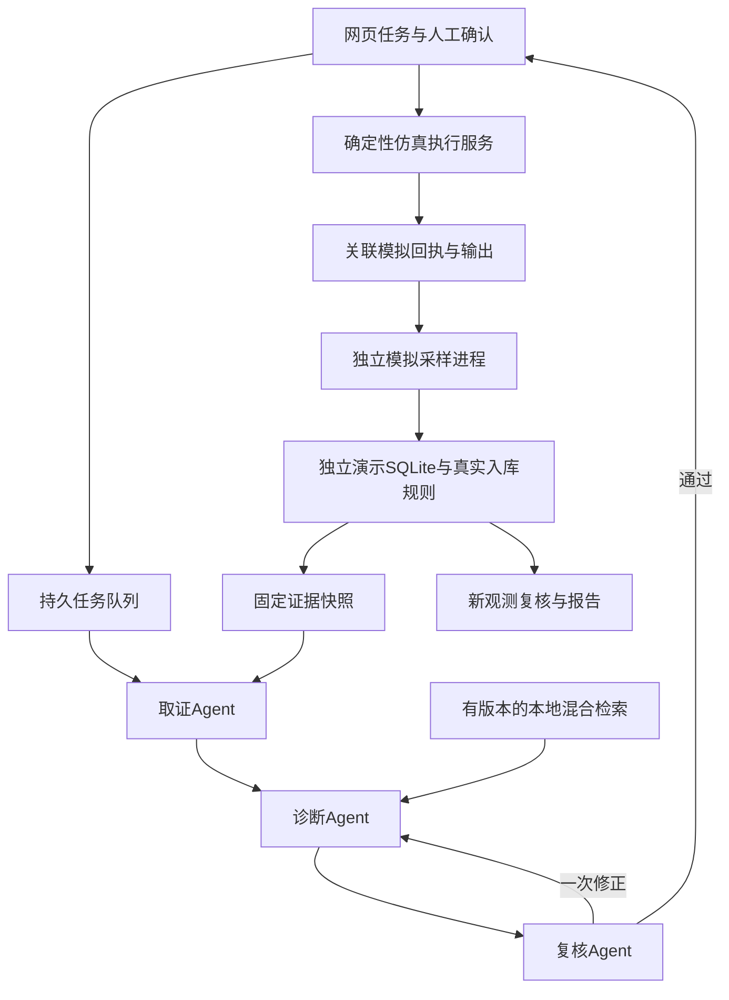

# 三Agent本地软件参赛版

状态与实际结果见 [验收记录](validation.md)；复现见 [启动部署说明](../../deploy/agent-demo/README.md)。最终模型批次因HTTP 402未完成验收，不能把软件实现状态当作参赛成熟度证明。

当前布局：700×700×300 mm，四角STM32F103RCT6，五站31个物理模块，控制器归属11/7/6/7；FAN-01归CTRL-04，FAN-02归CTRL-02。P5无温湿度模块；无水泵。S3网关与S3语音终端为两块独立设备。本轮仅软件模拟，语音、RS-485及真机验收仍待完成。

## 工作流与预算

- 取证、诊断、复核有独立上下文、工具白名单和实际模型响应。简单巡检只取证；复杂排障走三Agent。保留单Agent与原悬浮助手。
- 单次总期限120秒，最多12次模型调用、12次工具调用；只允许一次补充取证和一次诊断修订。耗尽保留轨迹和失败。
- 服务器冻结快照、校验设备及E/K编号、可选结构化事实。自然语言未被全部自动验证，独立复核也不是人工事实评分。
- 工单先草案后人工确认；幂等重试复用编号。恢复复核不自动结单。取消任务不会重新变成完成。
- 仿真动作使用明确FAN编码、四节点协议校验、人工确认及120秒有效期。重置场景使旧动作失效；回执关联命令UUID、控制器和场景代次。
- 状态区分建议、确认、模拟发送、模拟回执、模拟输出；新的模拟RPM来自下一采样轮。拒绝、超时和无关回执不能应用输出。
- 回执不能解除报警；恢复由新鲜有效观测与现有规则处理。模拟结果不计MQTT/RS-485真机通过。

## 数据与模型身份

`.agent-demo` 与原业务库、`.agent-eval`、本轮 `.agent-eval-sprint` 分离。场景控制仅管理员，运维员可确认测试动作与工单，查看者只读。场景路由仅服务端隔离配置注册，客户端不能启用测试模式。硬件发布保护保留。

启动、暂停、推进与重置不会自动调用模型。暂停停止观测和心跳，旧时间不被刷新；恢复才生成新观测。新任务可以引用旧任务快照的差异，但旧判断不被改写。

V16/V17原件保留，31路通过版本化映射定位；GLB内部主控文字仍是旧编号，界面继续提示。缺少绑定时不能声称定位成功。源代码与模型映射一致不代表实际接线已核验。

## 知识来源与适用限制

本地BM25和 `BAAI/bge-small-zh-v1.5` 用RRF融合返回最多5段，索引按知识版本和模型文件指纹缓存；没有本地模型时明确显示关键词降级。不联网推理，不引入独立向量数据库。

- 当前接线、四节点修复及项目手册：软件依据，非现场验收。
- [PR #31](https://github.com/x1ng-chen/utility-tunnel-digital-twin/pull/31)历史缺陷：保留旧双节点、ESP8266及当时验证程度；默认不参加当前检索，须明确勾选历史案例。旧引脚、旧命令不能作为当前操作依据。
- GB 51354-2019：已下载省市场监管局公开正文，逐页核对PDF第18、29、33页，收录6个条款的项目自拟摘要。来源、PDF散列、条号和印刷页码在 [条款片段](verified-standard-excerpts.json)。仅部分内容，不代表全文覆盖或合规认证。[发布公告](https://www.mohurd.gov.cn/gongkai/zc/wjk/art/2019/art_17339_240714.html)
- GB/T 50838-2015（2024年版）：已核对改名与2025-04-01施行公告；修订正文尚未核实完整，继续作为知识缺口显示，禁止以公告编造条文。[修订公告](https://www.mohurd.gov.cn/gongkai/zc/wjk/art/2024/art_3383d6cebf26480cb76d49204a5fad44.html)

检索资料是低信任数据，不能扩大工具权限；检索命中不代表建议正确。未标定ADC不换算可信ppm，AO-02直连ADC不提供人员进入安全结论。

## 能耗、成本与评测

范围仅双风机支路；有效W/mW按采样间隔积分，跨时段电价拆分，坏质量与缺失区间不当成零功率。缺电价或覆盖不足时总电费未知。用户输入统一标记假设，不接受客户端自称实测。

工时当量、模型费用、ROI均显示输入与限制；不推断实际减薪、探头寿命、已避免事故或真实节能收益。电价须配置；不能把两路INA当成全系统能耗。

真实调用需显式 `--live`，普通测试均为模型桩。单/三Agent共享相同数据包、模型、工具池和总预算；普通问答读取同源原始包与手册，没有工具与答案键。人工操作和事实评分待独立执行。三组对比未完成前不写预设提升比例。

## 交付后仍需完成

补齐已核实修订正文与更多检索金标准；修复真实模型失败并在同一版本复测；开展人工事实评分和人工组。再推进小智、真实遥测及公网评委入口。

Issue #17/#18/#19保持实物验收边界，软件模拟不能替代现场通过。
